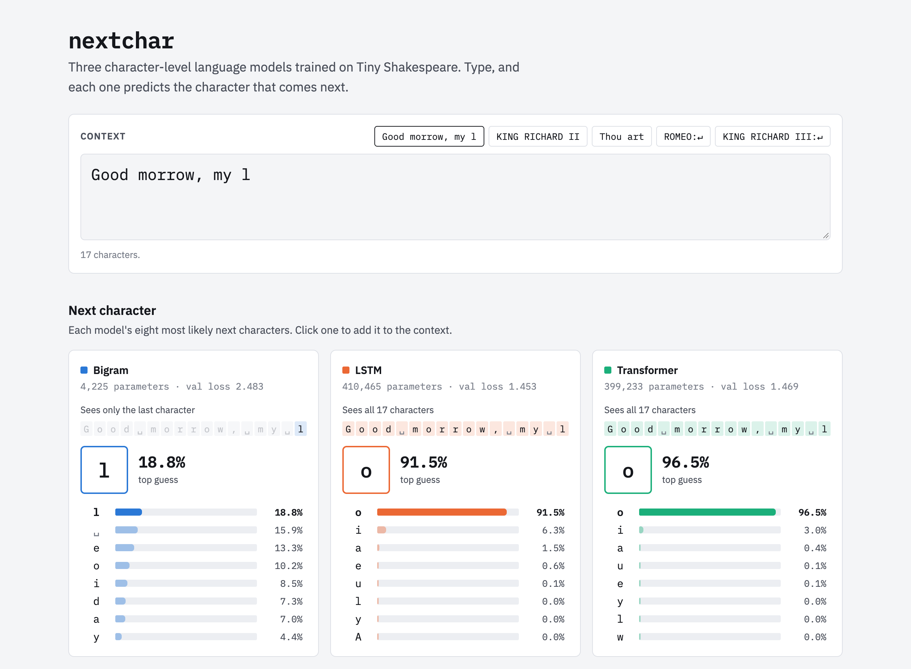
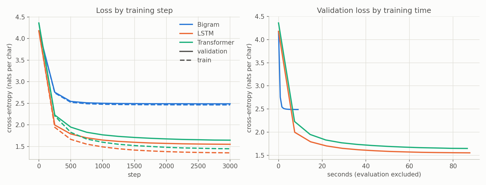
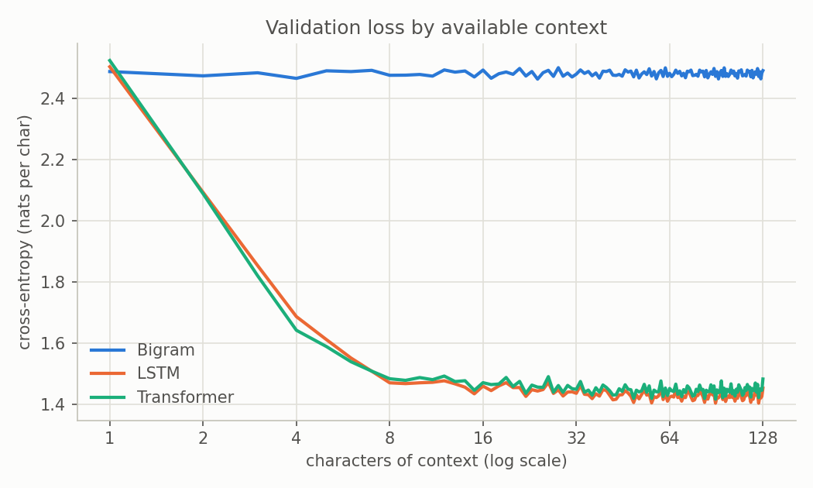

# NextChar

Character-level language modelling on Tiny Shakespeare: given the text so far, predict the next
character. Three models, a **bigram** table, an **LSTM**, and a small **transformer**, are trained
under one controlled budget so the comparison is fair.

[](https://github.com/as-obaid/nextchar/actions/workflows/ci.yml)
[](LICENSE)

**[Live demo](https://as-obaid.github.io/nextchar/):** type any text and watch all three models
predict the next character side by side, sample continuations, and inspect what the transformer
attends to. Everything runs in your browser.

[](https://as-obaid.github.io/nextchar/)

## Results

| Model | Parameters | Train loss | Val loss | Val perplexity | Training time | Sample quality | Notes |
| --- | ---: | ---: | ---: | ---: | ---: | --- | --- |
| Bigram | 4,225 | 2.457 | 2.483 | 11.98 | 23 s | Low | Matches a count-based bigram (2.484) |
| LSTM | 410,465 | 1.172 | **1.453** | **4.28** | 220 s | Medium | Lowest loss, in half the transformer's time |
| Transformer | 399,233 | 1.252 | 1.469 | 4.34 | 458 s | Medium | Best with ≤ 6 characters of context; overfits least |

Cross-entropy in nats per character on held-out text; 7,500 steps per model on an Apple M1 Pro
(MPS), keeping each model's checkpoint with the lowest validation loss. Both neural models use
the winners of the same tuning search ([Tuning](#tuning)). Full numbers:
[`results/results.md`](results/results.md).

- **The LSTM still wins, narrowly.** After the same tuning and a longer run, its lead is 0.015
  nats (0.094 at the original shared settings), and it trains in half the time.
- **Tuning helped the transformer most.** A higher learning rate, AdamW with β2 0.99 and weight
  decay, and four narrow layers instead of two wide ones cut its loss by 0.115. The same search
  gained the LSTM 0.067, and the deeper shape made the LSTM worse.
- **The bigram is at its ceiling.** The trained table (2.483) matches a bigram built by counting
  character pairs (2.484). More training cannot help it.
- **The last 8 characters do most of the work.** Both neural models get most of their gain from
  them, then improve slowly out to about 32–64. The transformer is better with ≤ 6 characters of
  context and the LSTM from 8 on.

Training curves (train dashed, validation solid), then validation loss by how many characters of
context each prediction had:




### Samples

The start of each model's continuation of `ROMEO:`, at temperature 0.8 with the same seed. Full
samples: [`results/samples.md`](results/samples.md).

**Bigram**

```text
ROMEO:
Cars an thedeneane in rolound e we anonthoute thilou wist ic wis ter; bea yonsenimes …
```

**LSTM**

```text
ROMEO:
Carlish that we citizen, in a way
To one of the blood in births, then, back, she's so.

JULIET:
That my mouth has your ancient love?
```

**Transformer**

```text
ROMEO:
Carleaful deed, Edward, look, when thou art so?
Thou art bid me strength to nothing courtesy;
The art your father of glass, as therefore you have
power your instruct and go to be myself
```

## Quickstart

```bash
pip install -r requirements.txt
python train.py     # trains all three models (~12 min on an M1 Pro)
python report.py    # results table, figures, and samples in results/
pytest              # model and data checks
```

Trained weights are in `checkpoints/`, so `report.py` and the demo work without retraining. On
Google Colab: `!git clone https://github.com/as-obaid/nextchar`, `%cd nextchar`, then the same
commands with a leading `!`.

To run the demo locally, serve `docs/` over HTTP. After retraining, re-export its weights and check
that the browser models still match PyTorch (needs Node):

```bash
python -m http.server -d docs 8000   # http://localhost:8000
python export_web.py                 # checkpoints/ -> docs/assets/
python scripts/web_parity.py         # JS vs PyTorch logits, tolerance 1e-4
```

## Models

All three map a window of characters to a next-character distribution at every position, and
share one training loop, loss, and sampler ([`models.py`](models.py)).

**Bigram.** A 65 × 65 table: the row for the current character is the distribution over the next
one. It uses exactly one character and ignores everything before it, so it learns pair statistics
(`q` → `u`, a capital after a newline) but has no notion of words, speakers, or lines. Its samples
are pronounceable nonsense, and two prompts that end in the same character produce the same
continuation.

**LSTM.** An embedding, two LSTM layers (hidden size 160), and a linear output. It reads left to
right, folding every earlier character into a fixed-size state through input, forget, and output
gates, which is enough to spell words, close lines, and write speaker tags. Everything it
remembers must pass through that state one step at a time, so older information is gradually
overwritten and gradients through long spans fade.

**Transformer.** Token and learned position embeddings, four pre-norm blocks, a final LayerNorm,
and a linear output. Each block applies 4-head causal self-attention (width 88, 22 dimensions per
head) and then a feedforward layer (88 → 352 → 88), each behind a LayerNorm and inside a residual
connection. Each position compares its query with the keys of every earlier position and takes a
weighted mix of their values, so it can read any earlier character directly instead of through a
summary. Attention is written out by hand in `CausalSelfAttention`.

## Method

The models differ only in architecture and in the settings each was tuned to. Everything else is
shared.

**Shared by all three models**

- **Data:** [Tiny Shakespeare](https://github.com/karpathy/char-rnn) (1.1M characters, 65
  symbols), shipped as `data/input.txt`. It is split 90/10 into contiguous blocks before
  windowing, so no window crosses the split.
- **Budget:** the same 7,500 batches of 64 windows × 128 characters, in the same order.
- **Context:** 128 characters in training and generation. The LSTM state resets for every
  window, so it never sees more than the transformer.
- **Optimiser:** AdamW with weight decay on weight matrices only, 100-step linear warmup, cosine
  decay to 10% of the peak, gradient clipping at 1.0.
- **Evaluation:** the same fixed windows for every model, dropout off, every 250 steps. The
  checkpoint with the lowest validation loss is kept. Training time excludes evaluation.
- **Sampling:** the same prompts, temperature (0.8), length (500 characters), and seed.

**Per model**

| | Bigram | LSTM | Transformer |
| --- | ---: | ---: | ---: |
| Parameters | 4,225 | 410,465 | 399,233 |
| Peak learning rate | 1e-2 | 8e-3 | 8e-3 |
| AdamW β2 | 0.999 | 0.99 | 0.99 |
| Weight decay | 0.01 | 0.1 | 0.1 |
| Dropout | none | 0.1 | 0.1 |
| Best step | 5,250 | 6,750 | 6,750 |

The neural models use the winners of the tuning search below. The LSTM's hidden size of 160 keeps
its parameter count within 3% of the transformer's, so neither wins on size. The bigram keeps
AdamW defaults with a larger step, which takes it to its counting optimum.

### Tuning

`python tune.py` runs the same search for both neural models: three rounds (learning rate,
optimiser, shape), each applied on top of the best settings so far, at 3,000 steps per run. The
table shows validation loss after each run; bold marks a change that was kept.

| Round | Change | LSTM | Transformer |
| --- | --- | ---: | ---: |
| Start | lr 2e-3, β2 0.999, weight decay 0.01, 2 layers | 1.552 | 1.646 |
| Learning rate | 4e-3 | 1.519 | 1.606 |
| | 8e-3 | **1.490** | **1.594** |
| Optimiser | β2 0.99, weight decay 0.1 | **1.485** | **1.565** |
| Shape | deeper, same size: LSTM 3 × 128, transformer 4 × 88 | 1.551 | **1.531** |

**Depth is where the two models disagree.** Four narrow blocks beat two wide ones for the
transformer, since each extra attention layer can build on patterns found by the layers below it.
For the LSTM, a third layer had to come out of the width of its recurrent state (160 → 128), the
only place it stores memory, and it lost 0.066.

**Caveat:** settings were chosen on the validation split with a single seed, so differences under
about 0.01 may be noise. Per-model tables: [`results/tuning.md`](results/tuning.md).

## Analysis

| Question | Short answer |
| --- | --- |
| Which model performed best? | The LSTM, narrowly: validation perplexity 4.28, against 4.34 for the transformer and 11.98 for the bigram |
| Which trained fastest? | The bigram (23 s), though to a much worse loss. Of the neural models, the LSTM: 220 s against 458 s |
| Which generated the most realistic text? | The LSTM and the transformer, about equally ([Samples](#samples)). The bigram writes no real words |
| What did the transformer improve? | Predictions from short context, less overfitting, and the largest gain from tuning, but not the overall loss |
| Was it worth the complexity? | Not at this scale |
| Did the models overfit? | Mildly and late. Early stopping kept the best weights |

**Why the LSTM trains faster.** The four-layer transformer takes twice as long per step as the
two-layer version did, despite having fewer parameters. At this size, time per step follows the
number of layers more than the amount of arithmetic, so the transformer's ability to process
every position at once does not pay off on this hardware.

**What the transformer improved.** Against the bigram, it cuts perplexity by almost two-thirds and
turns letter pairs into words, verse lines, and speaker tags. Against the LSTM, it predicts better
from very short context (≤ 6 characters), overfits less (a train-to-validation gap of 0.22
against 0.28), and gained almost twice as much from tuning.

**Why it was not worth it here.** The transformer needed more tuning (a deeper shape, a higher
learning rate, weight decay) to come within 0.015 of the LSTM, and twice the training time. The
trend favours it, though: it closed most of the gap and overfits less, so more data, depth, or
training is where I would expect it to pull ahead.

**Overfitting.** Validation loss bottomed out at step 6,750 for both neural models and rose by
about 0.005 after, so early stopping kept the step-6,750 weights. Most of the train-to-validation
gap is not memorisation. It is already 0.16 at step 500, because the validation split is the end
of the file, which holds different plays from the training text.

**What I learned about attention.** Attention makes every earlier character reachable, but the
model still has to learn to use them. The context curve shows the transformer takes most of its
gain from the last 8 characters, just like the LSTM. Training does extend that reach. With the
original settings, the `ROMEO:` and `KING RICHARD III:` prompts led every model to identical text
within a few lines. With the tuned settings, both neural models' continuations split early and
never rejoin.

## Reflection

The most useful decisions were about the comparison, not the models: fixing the batches, matching
parameter counts, tuning both models with the same search, and checking the bigram against its
counting optimum made the numbers interpretable. Tuning mattered more than I expected. The same
search moved the transformer almost twice as far as the LSTM, and the first comparison, at shared
default settings and 3,000 steps, put the LSTM's lead at six times what it is now. The
per-position loss and the samples explained what the totals could not. Next steps would be
several seeds per model for error bars, a separate test split (settings were chosen on
validation), and a larger budget to find where the ranking flips.

## Repository

```text
nextchar/
├── data.py         vocabulary, contiguous split, batching, fixed evaluation windows
├── models.py       BigramLM, LSTMLM, TransformerLM, and the shared sampler
├── train.py        shared budget and per-model settings; trains all three models
├── tune.py         the same tuning search for both neural models
├── report.py       results table, figures, and samples
├── export_web.py   exports the checkpoints to docs/assets/ for the demo
├── data/           Tiny Shakespeare (input.txt, 1.1 MB, public domain)
├── checkpoints/    trained weights for the three models
├── results/        metrics, tables, figures, and samples
├── docs/           the browser demo: plain-JS ports of the models, no build step
├── scripts/        parity check between the JS models and PyTorch
└── tests/          shape, causality, and data-pipeline checks
```

## References

- D. Jurafsky and J. H. Martin, *Speech and Language Processing*, 3rd ed. draft:
  "N-gram Language Models", "RNNs and LSTMs", "Transformers and Pretraining".
  https://web.stanford.edu/~jurafsky/slp3/
- S. Hochreiter and J. Schmidhuber, "Long Short-Term Memory," *Neural Computation*, 1997.
- A. Vaswani et al., "Attention Is All You Need," *NeurIPS*, 2017.
- A. Karpathy, [char-rnn](https://github.com/karpathy/char-rnn), source of the Tiny Shakespeare text.

## License

[MIT](LICENSE). Tiny Shakespeare is public domain.
